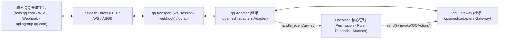

# opsmesh-adapter-qq

面向 **[OpsMesh](https://github.com/jhupo/OpsMesh)** 的原生全异步腾讯官方 QQ 机器人协议适配器（顶层导入包名：`qq`）。

本项目完整对标 `nonebot/adapter-qq` 的官方开放平台协议覆盖面（**QQ 群聊 v2 + 单聊 C2C v2 + 官方群管理 v2 全量 11 项 API + 富媒体单步/BDH 分片上传 + 流式消息 `MessageStream` + 频道 Guild v1**），100% 复用 OpsMesh 核心原语，不引入任何第三方 SDK。

> **职责边界**：本仓库仅提供纯粹、无状态的协议适配与原子 API 能力（含 `GROUP_OWNER` / `GROUP_ADMIN` 零开销角色权限原语）；具体的群管斜杠命令、违规计数、阶梯升级、安全护栏与对外独立群管异步函数 API 位于配套插件仓库 **[opsmesh-plugin-qq-admin](https://github.com/jhupo/opsmesh-plugin-qq-admin)**。

---

## 核心特性

- **双模入站传输**：
  - **WebSocket 客户端模式（默认）**：支持多机器人账号与多 Shard 分片并发、心跳探活、断线 `OP_RESUME (op=6)` 无缝补帧与 `OP_INVALID_SESSION (op=9)` 自动重鉴权，无需公网 IP；
  - **HTTP Webhook 回调模式（可选）**：基于 ASGI 驱动暴露 `POST /qq/webhook`，内置 `Ed25519` 请求验签（`op=0`）与平台回调地址探测挑战应答（`op=13`）。
- **被动回复 `msg_seq` 自动治理**：内置 `PassiveReplyTracker`（LRU+TTL），回复事件时自动绑定入站 `msg_id` 并原子递增 `msg_seq`（群聊 5 分钟 5 条、单聊 60 分钟 4 条），过期自动回退主动消息语义。
- **官方 v2 群管理 API 100% 覆盖**：完整封装群信息、Bot 本群角色与收消息状态、成员列表与单成员查询、成员单人/批量定时禁言与解禁、全体禁言规则查询、批量踢人与拉黑、群黑名单增删查、入群申请列表与审批、2 分钟内消息撤回。
- **全模态富媒体与流式输出**：支持文本、表情、图片、语音、视频、文件、Markdown、按钮键盘 `Keyboard`、Ark 与引用回复；支持大文件 BDH 分片上传（`prepare -> put_upload_part -> finish`）及 `MessageStream` 打字机流式回复。
- **严密封装无魔法字符串**：采用四层子包（`L0 -> message/ · event/ -> transport/ · api/ -> gateway · adapter`），所有动作统一由 `QQAction(StrEnum)` 与 `ActionDispatcher` 注册表路由。

---

## 系统架构总览



---

## 目录结构

```text
opsmesh-adapter-qq/
├── .github/workflows/          # CI (Linux/Windows × Py3.11-3.13) · CodeQL · Security · Release
├── docs/                       # 完整架构、双模传输、富媒体流式与 v2 群管契约设计文档
│   ├── 01-architecture.md
│   ├── 02-transport-ws-and-webhook.md
│   ├── 03-messaging-media-and-stream.md
│   └── 04-group-admin-v2-contracts.md
├── examples/qq_bot/            # 示例工程骨架
├── src/qq/                     # 顶层导入包 (from qq import Adapter, Gateway, ...)
│   ├── __init__.py             # 统一门面导出 (__all__)
│   ├── py.typed                # PEP 561 静态类型标记
│   ├── typing.py               # Intents IntFlag · OpCode IntEnum · QQAction StrEnum
│   ├── exception.py            # 继承 opsmesh.exception.*
│   ├── config.py               # BotConfig & Config
│   ├── utils.py                # 日志封装 · OpenID 校验 · DedupeRing · PassiveReplyTracker
│   ├── permission.py           # GROUP_OWNER / GROUP_ADMIN / GUILD_OWNER / GUILD_ADMIN
│   ├── message/                # segment.py · parser.py · serializer.py
│   ├── event/                  # base.py · models.py · group_c2c.py · group_notice.py · guild.py · interaction.py
│   ├── transport/              # protocol.py · ws_session.py · webhook.py
│   ├── api/                    # token.py · client.py · messaging.py · media.py · group_admin.py · guild_*.py · dispatcher.py
│   ├── gateway.py              # Gateway 门面
│   └── adapter.py              # Adapter 编排器
└── tests/unit/                 # 单元测试套件
```

---

## 设计文档导航

1. **[01-architecture.md](docs/01-architecture.md)** — 四层模块化架构、单向依赖 DAG、类关系图、配置契约与 `QQAction` 全量 55+ 接口路由表。
2. **[02-transport-ws-and-webhook.md](docs/02-transport-ws-and-webhook.md)** — WebSocket 分片连接状态机、`OP_RESUME` 断线补帧时序、Webhook `Ed25519` 验签与挑战应答时序。
3. **[03-messaging-media-and-stream.md](docs/03-messaging-media-and-stream.md)** — OpenID 隔离体系、被动回复 `msg_seq` 自动递增流程、`file_info` 富媒体与 BDH 分片上传时序、`MessageStream` 流式消息时序。
4. **[04-group-admin-v2-contracts.md](docs/04-group-admin-v2-contracts.md)** — 官方 QQ 群管理 API v2 全量 11 个接口契约、入群/成员通知事件及与 `opsmesh-plugin-qq-admin` 的协作边界。

---

## 开源许可

本项目采用 [MIT License](LICENSE) 开源。
