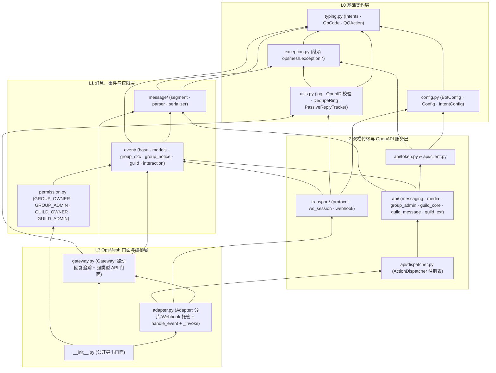

# 01. 总体架构、模块依赖与全量接口契约设计

本文档定义 `opsmesh-adapter-qq`（顶层包名 `qq`）的系统边界、四层子包依赖关系、Python 3.11+ 编码契约，以及完整对齐 `nonebot/adapter-qq` 的配置与全量 API 清单。

---

## 1. 核心架构原则

1. **100% 走 OpsMesh 原生机制**：
   - 事件继承 `opsmesh.adapters.Event`，统一调用 `opsmesh.message.handle_event(gateway, event)` 进入框架标准管线；
   - 消息继承 `opsmesh.adapters.{Message, MessageSegment}`，直接复用基类切片、拼接、`extract_plain_text()` 与 `Message.template()`；
   - 出站调用 100% 经 `Gateway.invoke(QQAction.*, **params)` -> `Adapter._invoke()` -> `ActionDispatcher`，完整支持 `@Gateway.before_invoke` / `after_invoke` 与 `MockInvokeResult`；
   - 网络传输 100% 委托给 `Adapter.request()`、`stream_request()`、`websocket()` 与 `setup_http_server()`。
2. **协议原子能力与群管业务策略解耦**：
   - 适配器完整提供腾讯官方 v2 群管事件、11 个群管 REST 接口与零 I/O 角色权限（`GROUP_OWNER`、`GROUP_ADMIN`）；
   - 群管命令、违规计数、阶梯升级、每日配额护栏与对外独立异步函数 API 统一由独立插件仓库 `opsmesh-plugin-qq-admin` 实现。

---

## 2. 四层模块单向无环依赖图（DAG）

---

## 3. 配置模型契约（`src/qq/config.py`）

### 3.1 `IntentConfig`（事件订阅意图位配置）

默认启用最常用的群聊/单聊、频道公域 `@` 与频道私信，支持按布尔开关精确控制 `Intents` 整数位掩码：

| 字段名 | 默认值 | 位值 | 覆盖事件范围 |
| :--- | :---: | :--- | :--- |
| `guilds` | `True` | `1 << 0` | 频道与子频道增删改 |
| `guild_members` | `True` | `1 << 1` | 频道成员进退与更新 |
| `guild_messages` | `False` | `1 << 9` | 私域机器人频道全量消息 |
| `guild_message_reactions` | `True` | `1 << 10` | 频道消息表情表态 |
| `direct_message` | `True` | `1 << 12` | 频道私信（DMS） |
| `open_forums_event` | `False` | `1 << 18` | 公域论坛事件 |
| `audio_or_live_channel_member` | `False` | `1 << 19` | 音视频/直播子频道成员进退 |
| `c2c_group_at_messages` | `True` | `1 << 25` | **QQ 单聊、群 `@`、进退群、入群申请、机器人开关通知** |
| `interaction` | `True` | `1 << 26` | 互动按钮点击回调 `INTERACTION_CREATE` |
| `message_audit` | `True` | `1 << 27` | 消息审核通过/驳回通知 |
| `forum_event` | `False` | `1 << 28` | 私域论坛事件 |
| `audio_action` | `False` | `1 << 29` | 音频子频道麦序动作 |
| `public_guild_messages` | `True` | `1 << 30` | 公域机器人频道 `@` 消息 |

### 3.2 `BotConfig` 与 `Config`

| 字段名 | 类型 | 默认值 | 说明 |
| :--- | :--- | :--- | :--- |
| `app_id` | `str` | 必填 | QQ 开放平台机器人 `AppID`（网关 ID 为 `"qq:{app_id}"`） |
| `app_secret` | `SecretStr` | 必填 | 机器人 `AppSecret`（用于换取 Token 及派生 Webhook Ed25519 密钥） |
| `transport` | `Literal["websocket", "webhook"]` | `"websocket"` | 入站接收模式 |
| `is_sandbox` | `bool` | `False` | 是否连接沙箱域名 `sandbox.api.sgroup.qq.com` |
| `intent` | `IntentConfig` | 默认意图集 | WebSocket `IDENTIFY` 订阅位 |
| `shard` | `tuple[int, int] \| None` | `None` | 手动指定分片 `(shard_id, total_shards)`；`None` 时按 `/gateway/bot` 自动分片 |
| `auto_markdown` | `bool` | `False` | 群聊/单聊纯文本是否默认使用 `msg_type=2` Markdown 发送 |
| `qq_webhook_path` | `str` | `"/qq/webhook"` | Webhook 模式挂载的 ASGI POST 路由路径 |

---

## 4. 全量动作与服务分层映射表（对标 `nonebot/adapter-qq` 全集）

| 所属服务模块 (`src/qq/api/`) | 包含的 `QQAction` / `Gateway` 强类型方法 |
| :--- | :--- |
| `token.py` | `get_access_token` |
| `messaging.py`（C2C & 群消息 v2） | `me` · `url_get` · `shard_url_get` · `put_interaction` · `post_c2c_messages` · `delete_c2c_message` · `post_group_messages` · `delete_group_message` · `send_group_stream` · `send_c2c_stream` |
| `media.py`（富媒体与 BDH 分片） | `post_c2c_files` · `post_c2c_upload` (`prepare` / `put_upload_part` / `part_finish`) · `post_group_files` · `post_group_upload` (`prepare` / `put_upload_part` / `part_finish`) · `download_attachment` |
| **`group_admin.py`（官方群管 v2 全集）** | `get_group_info` · `get_group_bot_state` · `post_group_members` · `get_group_members` · `get_group_member` · `get_group_mute_setting` · `set_group_members_mute` · `get_group_join_request_list` · `approval_join_request` · `batch_remove_group_members` · `get_group_member_blacklist` · `post_group_member_blacklist` |
| `guild_core.py`（频道核心 v1） | `guilds` · `get_guild` · `get_channels` · `get_channel` · `post_channels` · `patch_channel` · `delete_channel` · `get_members` · `get_role_members` · `get_member` · `delete_member` · `get_guild_roles` · `post_guild_role` · `patch_guild_role` · `delete_guild_role` · `put_guild_member_role` · `delete_guild_member_role` · `get_channel_permissions` · `put_channel_permissions` · `get_channel_roles_permissions` · `put_channel_roles_permissions` |
| `guild_message.py`（频道消息 v1） | `get_message_of_id` · `post_messages` · `delete_message` · `get_message_setting` · `post_dms` · `post_dms_messages` · `delete_dms_message` · `put_message_reaction` · `delete_own_message_reaction` · `get_reaction_users` · `put_pins_message` · `delete_pins_message` · `get_pins_message` · `post_guild_announces` · `delete_guild_announces` |
| `guild_ext.py`（频道扩展 v1） | `patch_guild_mute` · `patch_guild_member_mute` · `patch_guild_mute_multi_member` · `get_schedules` · `get_schedule` · `post_schedule` · `patch_schedule` · `delete_schedule` · `audio_control` · `put_mic` · `delete_mic` · `get_threads_list` · `get_thread` · `put_thread` · `delete_thread` · `get_guild_api_permission` · `post_api_permission_demand` |
