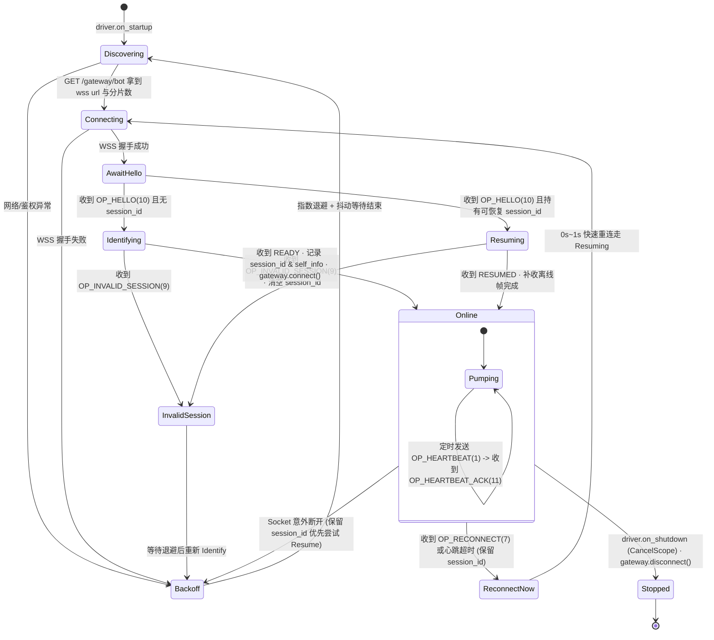
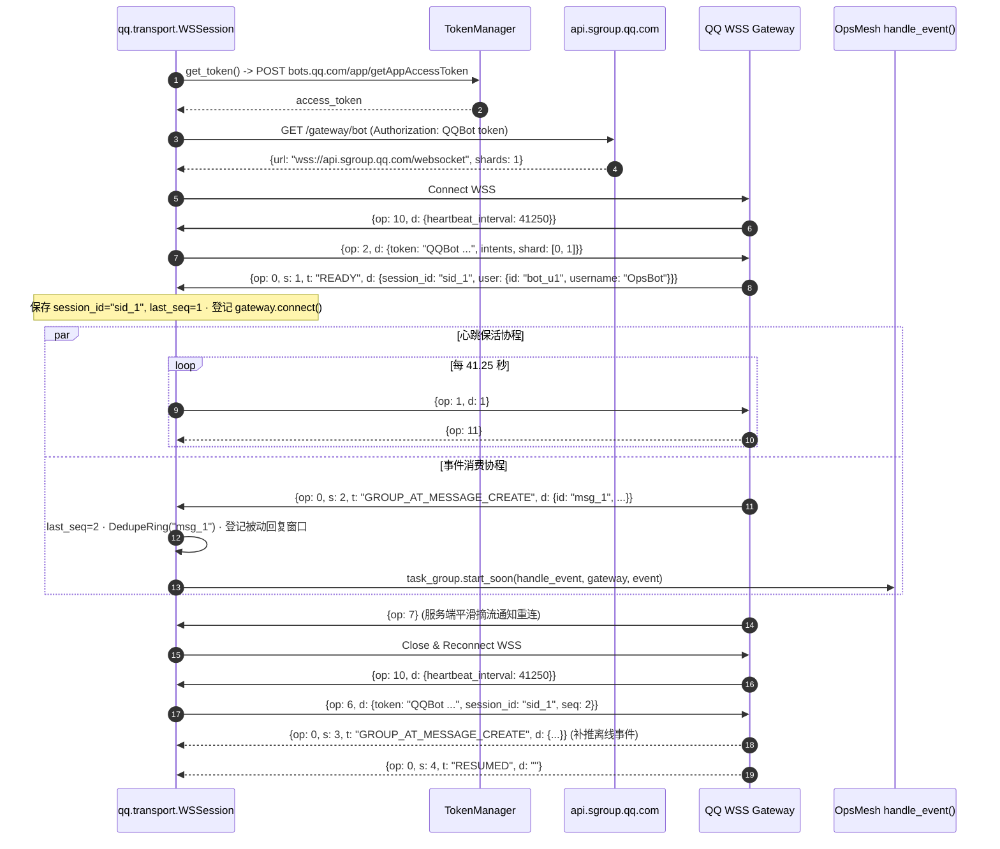
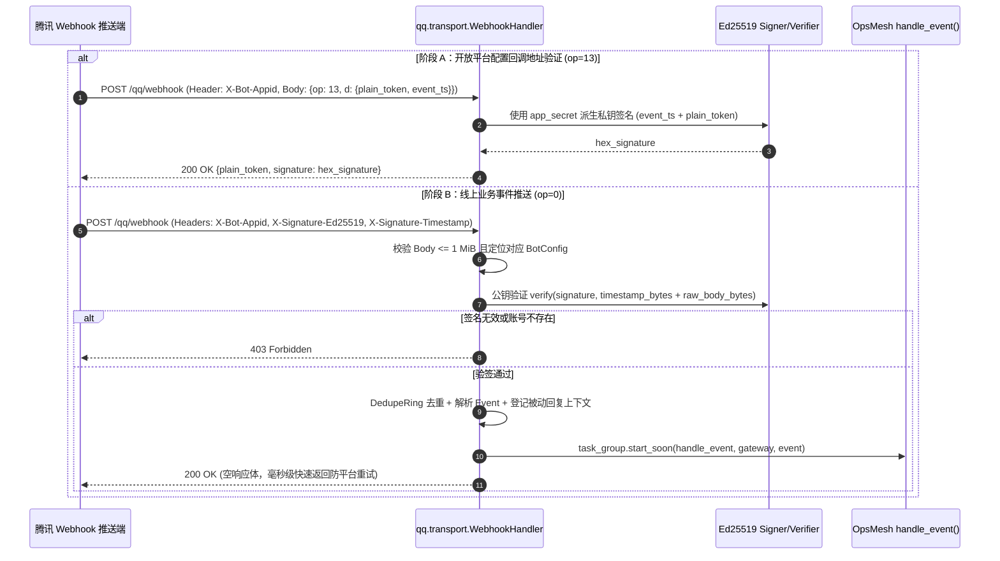

# 02. 双模入站传输协议设计（WebSocket 分片状态机 + Ed25519 Webhook）

本文档定义 `src/qq/transport/` 下 **WebSocket 客户端分片保活恢复** 与 **HTTP Webhook 验签回调** 两套入站接入机制的状态机与时序流程。

---

## 1. OpCode 协议帧定义

| OpCode | 名称 | 方向 | 作用 |
| :---: | :--- | :---: | :--- |
| `0` | `DISPATCH` | 服务端 -> 客户端 | 业务事件推送（携带序列号 `s` 与事件名 `t`） |
| `1` | `HEARTBEAT` | 双向 | 客户端定时发送最新 `s`；若收到服务端 `op=1` 立即回传一次心跳 |
| `2` | `IDENTIFY` | 客户端 -> 服务端 | 新连接鉴权、声明 `intents` 与 `shard: [id, count]` |
| `6` | `RESUME` | 客户端 -> 服务端 | 断线重连后携带 `session_id` 与 `last_seq` 请求补发离线事件 |
| `7` | `RECONNECT` | 服务端 -> 客户端 | 服务端通知客户端主动断开并立即执行 `RESUME` 重连 |
| `9` | `INVALID_SESSION` | 服务端 -> 客户端 | `IDENTIFY` 参数错误或 `RESUME` 会话过期，清空 `session_id` 重新鉴权 |
| `10` | `HELLO` | 服务端 -> 客户端 | WSS 建连首帧，下发 `heartbeat_interval`（毫秒） |
| `11` | `HEARTBEAT_ACK` | 服务端 -> 客户端 | 心跳确认帧（连续未收到触发断线重连） |
| `13` | `WEBHOOK_VERIFY` | 服务端 -> Webhook | HTTP 回调地址配置验证挑战帧 |

---

## 2. WebSocket 单分片连接状态机（`ws_session.py`）

多 Shard 场景下，同一个 `app_id` 只注册一个 `Gateway(id="qq:{app_id}")`：首个分片收到 `READY` 时调用 `gateway.connect()`，全部活跃分片均离线时调用 `gateway.disconnect()`。

---

## 3. 时序图 1：WebSocket 鉴权、心跳与 `OP_RESUME` 断线补帧

---

## 4. 时序图 2：HTTP Webhook `Ed25519` 挑战验证与事件验签（`webhook.py`）

当 `BotConfig.transport == "webhook"` 时，由 `app_secret` 循环填充至 32 字节作为种子派生 `Ed25519PrivateKey` 与对应公钥：

