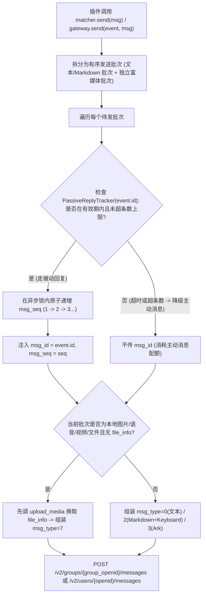
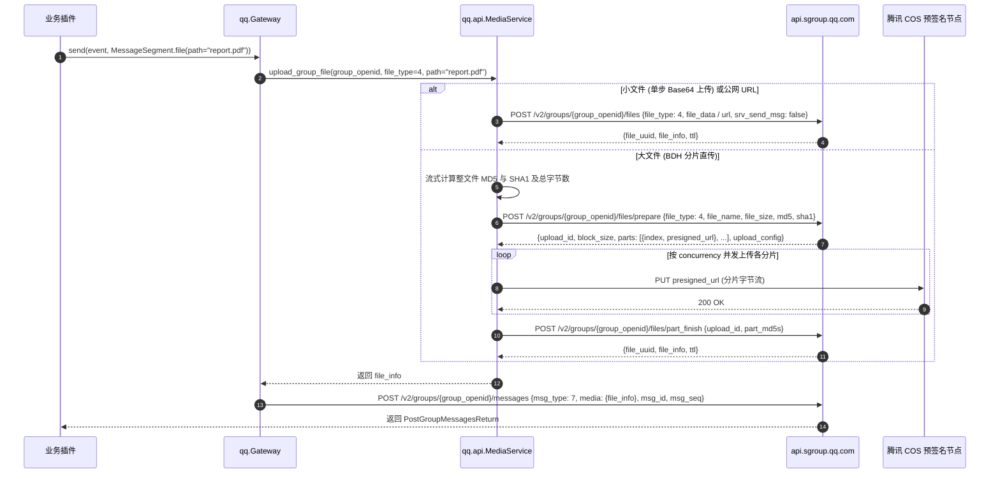
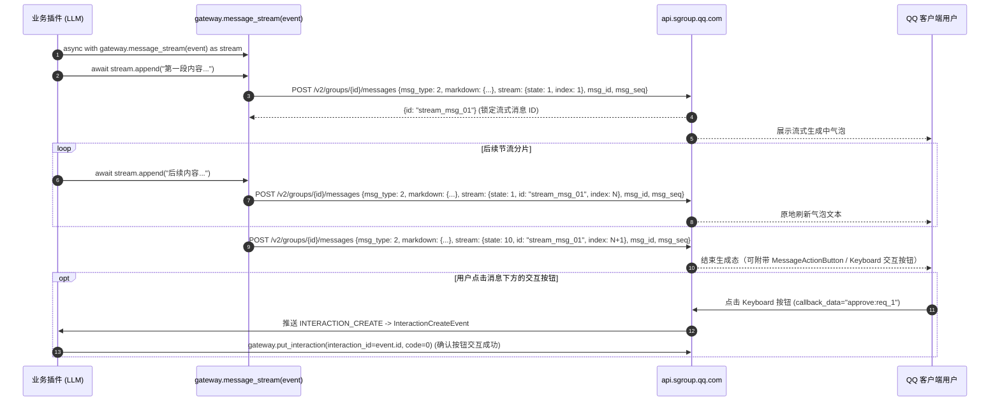

# 03. 消息模型、被动回复 `msg_seq` 治理、富媒体分片与流式输出设计

本文档定义 QQ 官方平台特有的 **OpenID 隔离体系**、**被动回复时效与 `msg_seq` 自动递增机制**、**`file_info` 富媒体与 BDH 大文件分片上传** 以及 **`MessageStream` 流式消息**。

---

## 1. OpenID 身份与会话隔离规则

腾讯官方 v2 协议不暴露数字 QQ 号与数字群号，所有标识均为当前 `AppID` 维度下的加密 OpenID：

| 场景 | 事件类 | `event.get_user_id()` | `event.get_session_id()` | `event.is_tome()` |
| :--- | :--- | :--- | :--- | :---: |
| QQ 单聊 | `C2CMessageCreateEvent` | `author.user_openid` | `f"c2c_{user_openid}"` | 恒为 `True` |
| QQ 群艾特消息 | `GroupAtMessageCreateEvent` | `author.member_openid` | `f"group_{group_openid}_{member_openid}"` | 恒为 `True` |
| QQ 群全量消息 | `GroupMessageCreateEvent` | `author.member_openid` | `f"group_{group_openid}_{member_openid}"` | 检查 `mentions` 含 `is_you` 或引用了本 Bot 消息 |
| 频道公域/全量消息 | `AtMessageCreateEvent` / `MessageCreateEvent` | `author.id` | `f"guild_{guild_id}_{channel_id}_{author.id}"` | `@` 事件恒为 `True`，全量消息检查 `@Bot` 或引用 |
| 频道私信 | `DirectMessageCreateEvent` | `author.id` | `f"dms_{guild_id}_{author.id}"` | 恒为 `True` |

> **入站文本净化**：群聊与子频道 `@Bot /cmd` 入站时，解析器自动剥离首部 `@Bot` 提及标签与紧随的前导空白，确保 OpsMesh `on_command("cmd", rule=to_me())` 在单聊、群聊、子频道中表现完全一致。

---

## 2. 被动回复 `PassiveReplyTracker` 与 `msg_seq` 自动递增流程

腾讯官方平台限制：**群聊被动回复有效期 5 分钟（最多回复 5 条），单聊被动回复有效期 60 分钟（最多回复 4 条）**，且针对同一 `msg_id` 多次发送时 `msg_seq` 必须严格递增，否则会被平台判定为重复请求吞没。

---

## 3. 时序图 3：富媒体单步上传与 BDH 大文件分片上传（`api/media.py`）

QQ 群聊与单聊发送图片（`1`）、视频（`2`）、语音 Silk（`3`）、文件（`4`）必须先换取 `file_info`：
- 小文件或公网 URL：直接调 `POST /v2/groups/{group_openid}/files`；
- 大文件本地字节流：走官方 **BDH 分片上传三步曲**（`prepare` 拿预签名分片 URL -> 并发 `PUT` 分片并计算 MD5 -> `part_finish` 合并换取 `file_info`，遇 `40093001` BDH 瞬态码自动重试一次）。

---

## 4. 时序图 4：`MessageStream` 流式消息与 `InteractionCreate` 按钮回调

QQ 官方 v2 原生支持在群聊/单聊中进行大模型打字机流式回复（`MessageStream`）：首片传 `state=1, index=1` 拿到流式会话 `id`，后续分片递增 `index` 并携带该 `id`，结束片传 `state=10` 固化消息。

